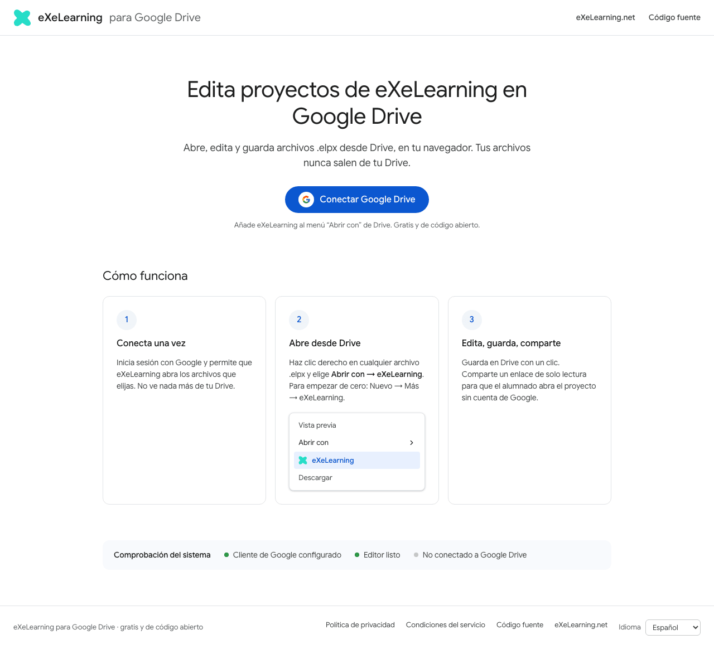
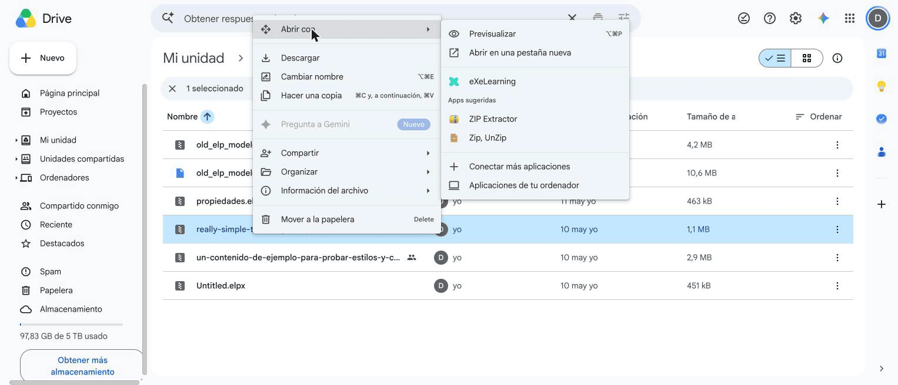
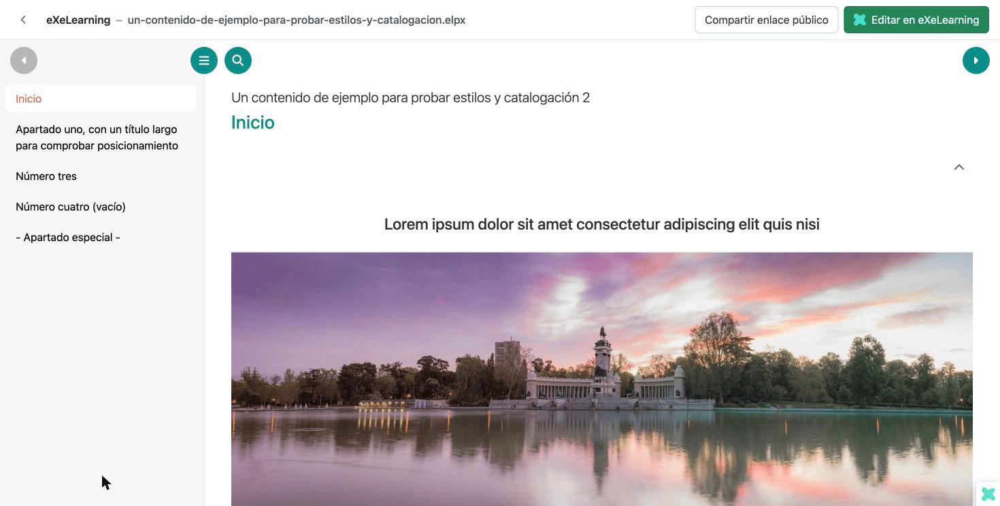
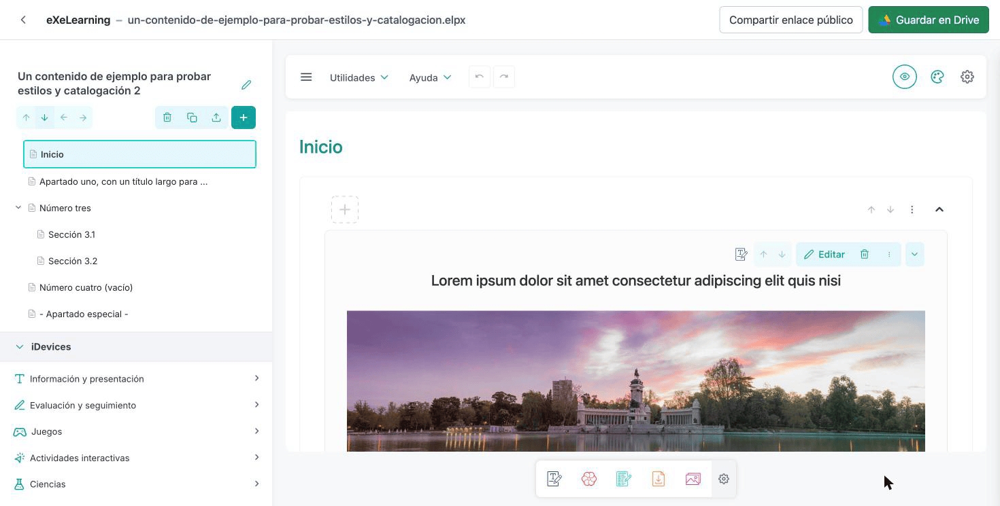
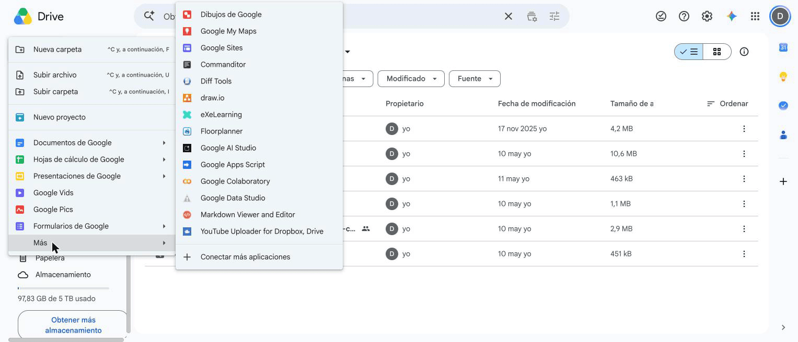
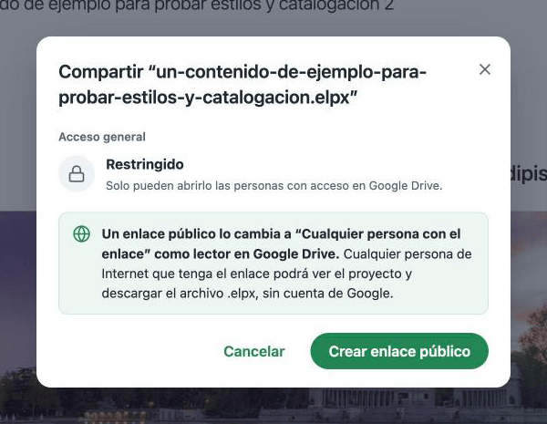
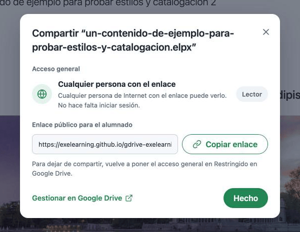
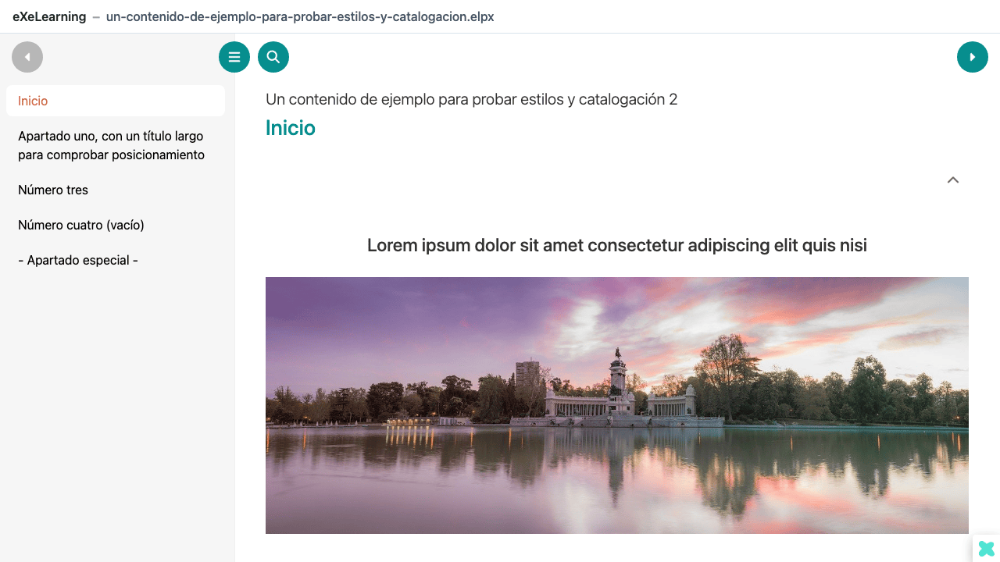

# eXeLearning en Google Drive

[Read in English](google-drive.md){ .lang-switch }

<!-- --8<-- [start:intro] -->

**eXeLearning para Google Drive** permite **abrir, editar y crear** recursos de eXeLearning
(`.elpx`) guardados en tu Drive, y **compartirlos con el alumnado** mediante un enlace público. No hay
que instalar nada: funciona en el navegador y los archivos nunca salen de Drive.

<!-- --8<-- [end:intro] -->

<!-- --8<-- [start:admin] -->

## Para administración { #administracion }

**No hay nada que instalar.** Cada docente puede usar la aplicación pública,
<https://exelearning.github.io/gdrive-exelearning/>, con su propia cuenta de Google, también con
cuentas de Google Workspace for Education. Es gratuita, no necesita servidor y solo accede a los
archivos que cada persona abre o crea con ella (permiso `drive.file`).

### Revisa tu dominio de Google Workspace

Si tu dominio restringe las aplicaciones de terceros, una persona con permisos de administración de
Workspace debe permitir **eXeLearning** en la **Consola de administración de Google** (**Seguridad →
Control de acceso y de datos → Controles de API → Gestionar el acceso de aplicaciones de terceros**).
Si no, el profesorado verá un error al autorizarla.

Los enlaces públicos para el alumnado necesitan que el archivo se comparta como **Cualquier persona
con el enlace**. Si tu dominio no permite compartir fuera de la organización, el profesorado verá un
error al crearlos; aun así podrá compartir archivos con personas del dominio desde Google Drive.

### Alojar una copia propia (opcional)

Una administración puede publicar su propia copia en lugar de usar la pública, por ejemplo para que
aparezca su nombre en la pantalla de permisos o para limitar el acceso a su dominio. La aplicación es
una web estática, así que sirve cualquier servidor web. Necesitas:

1. Un **proyecto de Google Cloud** con la **API de Google Drive** activada.
2. Una **pantalla de consentimiento OAuth** con los permisos `drive.file` y `drive.install`, y un
   **ID de cliente OAuth** para la dirección de tu web.
3. La **integración con la interfaz de Drive** apuntando a tu copia, para que eXeLearning aparezca en
   los menús **Abrir con** y **Nuevo** de Drive.
4. Una **clave de API** restringida a la API de Google Drive y a tu web, que usa la vista pública.
   Sin ella, el botón **Compartir enlace público** aparece desactivado.

Todos los pasos están en la
[guía de autoalojamiento](https://github.com/exelearning/gdrive-exelearning/blob/main/SELF-HOSTING.md)
(en inglés).

<!-- --8<-- [end:admin] -->

<!-- --8<-- [start:teacher] -->

## Para el profesorado { #profesorado }

### Requisitos

- Una cuenta de Google (personal o de tu centro).
- Un navegador actual.

### Primeros pasos

1. Entra en <https://exelearning.github.io/gdrive-exelearning/>.
2. Pulsa **Conectar Google Drive** y acepta los permisos. Así eXeLearning aparece en los menús
   **Abrir con** y **Nuevo** de Drive.

!!! info "Permisos que pide"
    Solo accede a los archivos que abras o crees con eXeLearning (permiso `drive.file`), no a todo tu
    Drive.

### Idioma

La aplicación está disponible en los mismos idiomas que eXeLearning. Usa el idioma de tu navegador;
para cambiarlo, elige otro en **Idioma**, al pie de la página de inicio. Los menús de Drive siguen el
idioma de tu cuenta de Google, y el editor mantiene el idioma que tenga configurado en sus
preferencias.

### Abrir un recurso

En Google Drive, haz clic derecho sobre un `.elpx` y elige **Abrir con → eXeLearning**. La primera
vez, pulsa **Autorizar y abrir**.

Se muestra una vista previa del recurso, lista para navegar. Pulsa **Editar en eXeLearning** para
editarlo, o **Compartir enlace público** para
[compartirlo con tu alumnado](#compartir-con-el-alumnado).

### Editar y guardar

El editor se abre en la misma pestaña. Cuando termines, pulsa **Guardar en Drive** (o Ctrl/Cmd + S).
El archivo se actualiza en Drive, con su miniatura.

- Si alguien cambió el archivo mientras lo editabas, podrás elegir entre sobrescribirlo, guardar una
  copia o cancelar.
- Los archivos que solo puedes ver se abren en modo lectura.
- Los `.elp` antiguos se guardan como un `.elpx` nuevo junto al original.

### Crear un recurso nuevo

En Drive, pulsa **Nuevo → Más → eXeLearning**. La primera vez, pulsa **Autorizar y crear**. El
archivo nuevo se crea en la carpeta en la que estás y se abre en el editor.

### Compartir con el alumnado { #compartir-con-el-alumnado }

Un enlace público permite al alumnado abrir el recurso en su navegador **sin cuenta de Google**.

1. Pulsa **Compartir enlace público**, en la vista previa o en el editor.
2. El diálogo avisa de que el archivo pasará a **Cualquier persona con el enlace** como **Lector** en
   Google Drive. Pulsa **Crear enlace público**.

    

3. Pulsa **Copiar enlace** y envía el enlace a tu alumnado: en tu curso, por correo o donde sueles
   compartir los materiales.

    

El alumnado ve el recurso como una web, con su menú, sin instalar nada ni iniciar sesión.

!!! warning "Cualquiera con el enlace puede verlo y descargarlo"
    Quien tenga el enlace puede ver el recurso y descargar su archivo `.elpx`. Para dejar de
    compartirlo, pulsa **Gestionar en Google Drive** (o usa el botón **Compartir** de Drive) y vuelve
    a poner el **Acceso general** en **Restringido**. A partir de ahí el enlace deja de funcionar.

Si el Google Workspace de tu centro no permite compartir fuera de la organización, el diálogo muestra
el error de Google. Aun así puedes compartir el archivo con docentes de tu dominio con el botón
**Compartir** de Drive; lo abrirán con **Abrir con → eXeLearning**.

Para que otros docentes puedan editar el archivo, usa el botón **Compartir** de Google Drive, como
con cualquier otro archivo.

<!-- --8<-- [end:teacher] -->
