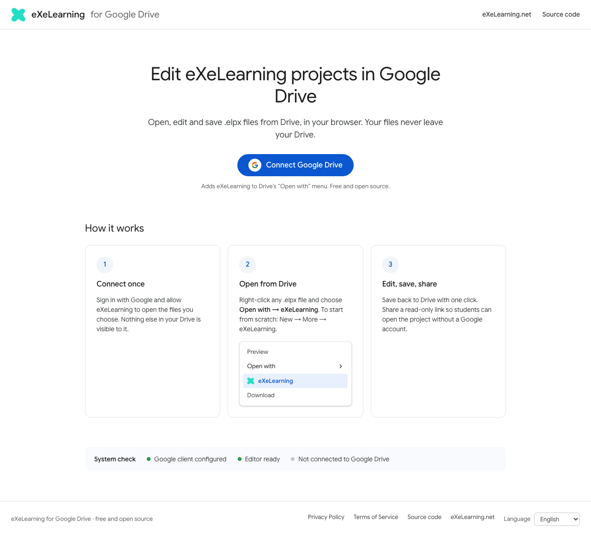
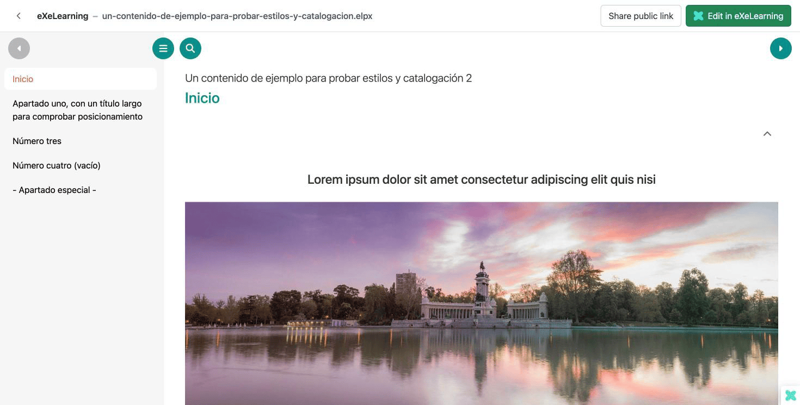
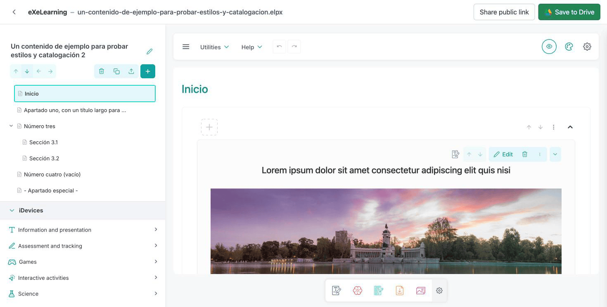
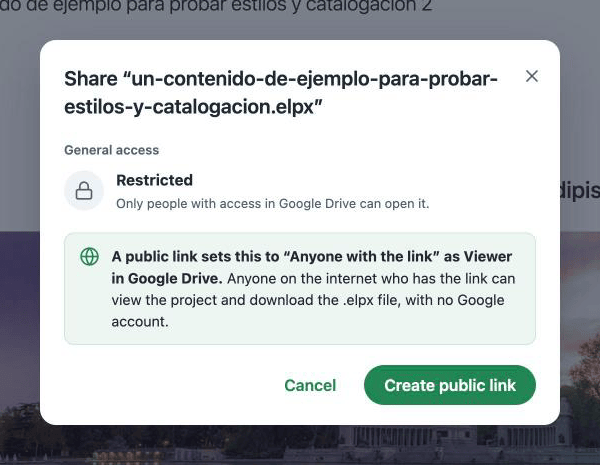
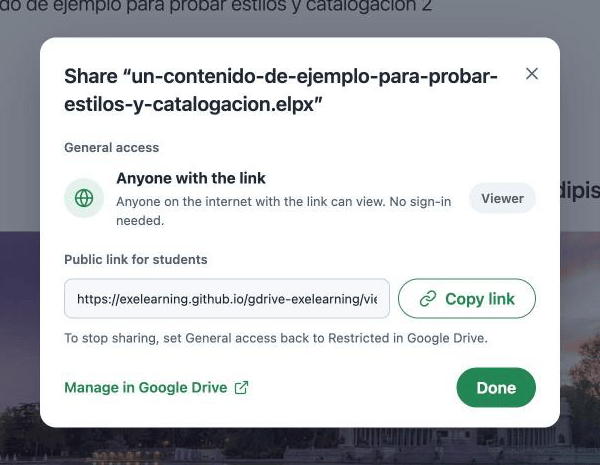

# eXeLearning in Google Drive

[Leer en español](google-drive.es.md){ .lang-switch }

<!-- --8<-- [start:intro] -->

**eXeLearning for Google Drive** lets you **open, edit and create** eXeLearning resources (`.elpx`)
stored in your Drive, and **share them with students** through a public link. There is nothing to
install: it runs in the browser and files never leave Drive.

<!-- --8<-- [end:intro] -->

<!-- --8<-- [start:admin] -->

## For administrators { #admin }

**Nothing to install.** Every teacher can use the public app at
<https://exelearning.github.io/gdrive-exelearning/> with their own Google account, including Google
Workspace for Education accounts. It is free, needs no server and only accesses the files each person
opens or creates with it (`drive.file` permission).

### Check your Google Workspace domain

If your domain restricts third-party apps, a Workspace administrator must allow **eXeLearning** in
the **Google Admin console** (**Security → Access and data control → API controls → Manage
third-party app access**). Otherwise teachers see an error when they authorize it.

Public links for students need files to be shared as **Anyone with the link**. If your domain does
not allow sharing outside the organization, teachers get an error when they create one; they can
still share files with people in the domain from Google Drive.

### Host your own copy (optional)

An administration can run its own copy instead of the public one, for example to show its own name
on the consent screen or to limit sign-in to its domain. The app is a static website, so any web
server works. You need:

1. A **Google Cloud project** with the **Google Drive API** enabled.
2. An **OAuth consent screen** with the `drive.file` and `drive.install` permissions, and an
   **OAuth client ID** for your website's address.
3. The **Drive UI integration** pointing to your copy, so that eXeLearning appears in Drive's **Open
   with** and **New** menus.
4. An **API key** restricted to the Google Drive API and to your website, used by the public view.
   Without it, the **Share public link** button stays disabled.

The [self-hosting guide](https://github.com/exelearning/gdrive-exelearning/blob/main/SELF-HOSTING.md)
has every step.

<!-- --8<-- [end:admin] -->

<!-- --8<-- [start:teacher] -->

## For teachers { #teachers }

### Requirements

- A Google account (personal or from your school).
- An up-to-date browser.

### Getting started

1. Go to <https://exelearning.github.io/gdrive-exelearning/>.
2. Click **Connect Google Drive** and accept the permissions. This adds eXeLearning to Drive's
   **Open with** and **New** menus.

!!! info "Permissions it asks for"
    It only accesses the files you open or create with eXeLearning (`drive.file` permission), not your
    whole Drive.

### Language

The app is available in the same languages as eXeLearning. It uses your browser's language; to
change it, pick another one in **Language** at the bottom of the home page. Drive's menus follow
your Google account's language, and the editor keeps the language set in its own preferences.

### Open a resource

In Google Drive, right-click an `.elpx` file and choose **Open with → eXeLearning**. The first time,
click **Authorize and open**.

A preview of the resource appears, ready to browse. Click **Edit in eXeLearning** to edit it, or
**Share public link** to [share it with your students](#share-with-students).

### Edit and save

The editor opens in the same tab. When you are done, click **Save to Drive** (or Ctrl/Cmd + S). The
file is updated in Drive, thumbnail included.

- If someone changed the file while you were editing, you can overwrite it, save a copy or cancel.
- Files you can only view open read-only.
- Old `.elp` files are saved as a new `.elpx` next to the original.

### Create a new resource

In Drive, click **New → More → eXeLearning**. The first time, click **Authorize and create**. The
new file is created in the folder you are in and opens in the editor.

### Share with students { #share-with-students }

A public link lets students open the resource in their browser **without a Google account**.

1. Click **Share public link**, in the preview or in the editor.
2. The dialog warns that the file will change to **Anyone with the link** as **Viewer** in Google
   Drive. Click **Create public link**.

    

3. Click **Copy link** and send the link to your students: in your course, by email or wherever you
   usually share materials.

    

Students see the resource as a website, with its menu, and nothing else to install or sign in to.

!!! warning "Anyone with the link can see and download it"
    Whoever has the link can view the resource and download its `.elpx` file. To stop sharing, click
    **Manage in Google Drive** (or use Drive's **Share** button) and set **General access** back to
    **Restricted**. The link then stops working.

If your school's Google Workspace does not allow sharing outside the organization, the dialog shows
Google's error. You can still share the file with colleagues in your domain using Drive's **Share**
button; they open it with **Open with → eXeLearning**.

To let other teachers edit the file, use Drive's **Share** button as with any other file.

<!-- --8<-- [end:teacher] -->
